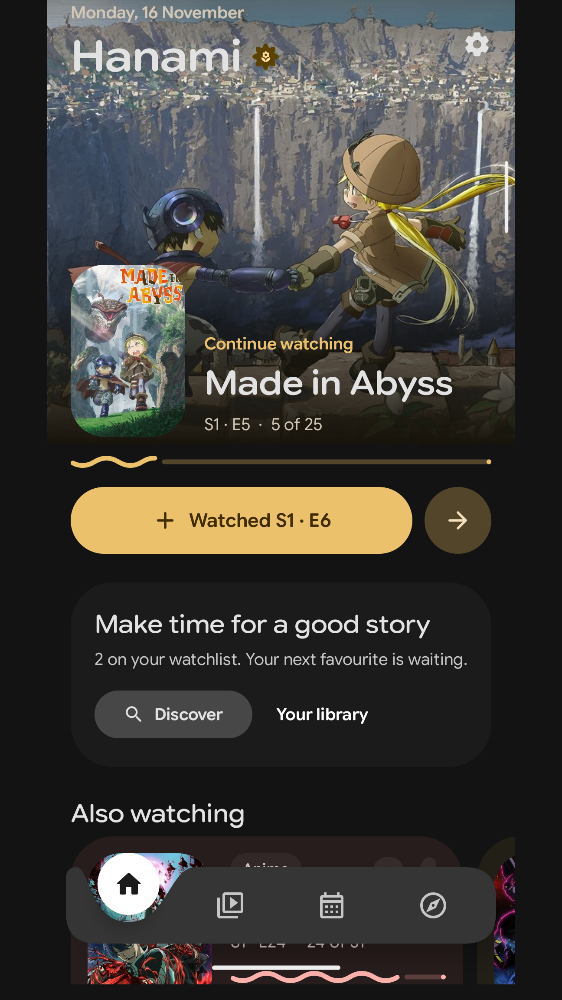
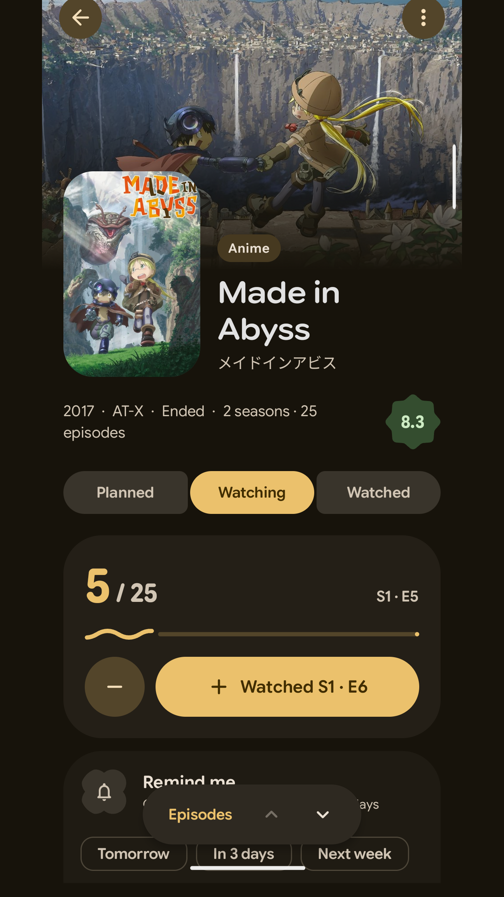
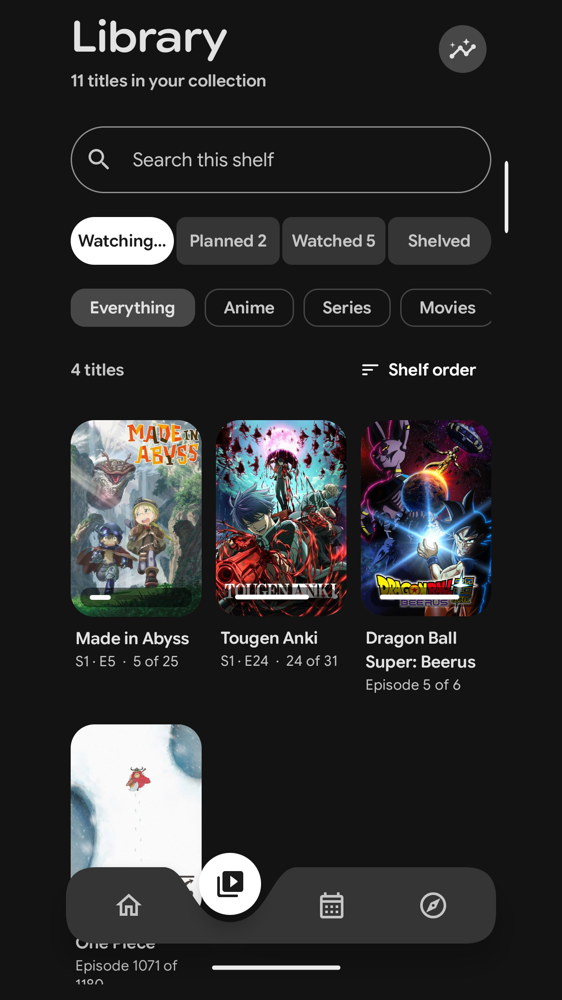
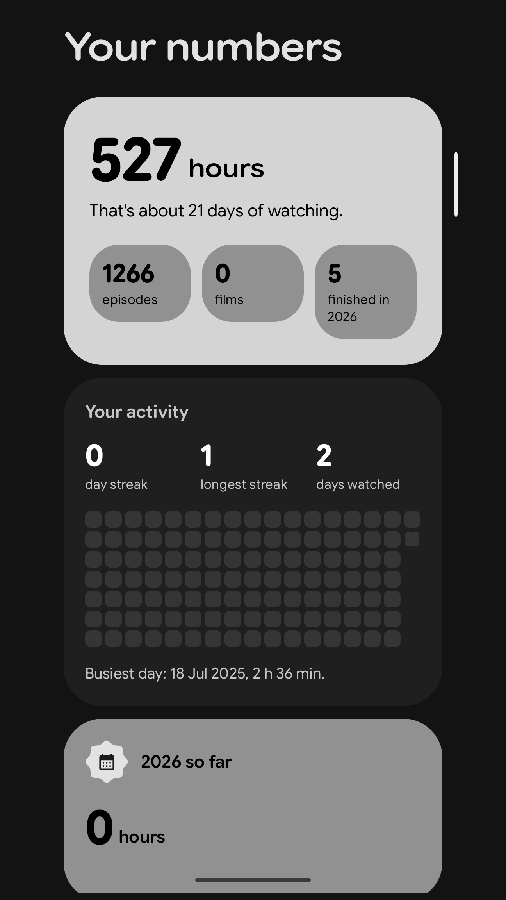
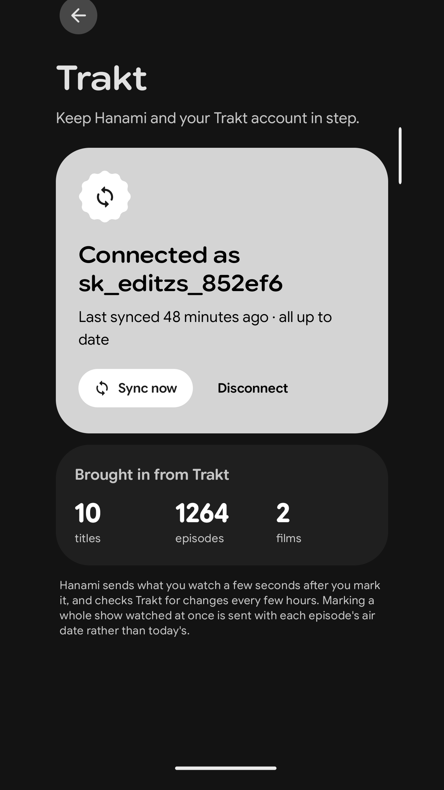

 

**A watch list for anime, series and films.** 
Material 3 Expressive, written in Kotlin and Jetpack Compose. 
Free, with no ads or Hanami account. Your list lives on your phone, with optional Trakt sync.

 

  

 

[Features](#whats-inside) · [Trakt](#trakt-sync) · [Install](#install) · [Privacy](#privacy) · [FAQ](#faq) · [Support](#support)

 

## Why Hanami?

Most trackers want an account before they'll let you tick off a single episode. Hanami
doesn't. Search for something, save it, and press **Watched** when you finish an
episode. Hanami keeps your place, tells you what's next and lets you know when a show
you're caught up on gets a new episode.

It doesn't stream, download or link to video. It's a tracker and nothing else.

## What's inside

<table>
<tr>
<td width="50%" valign="top">

**Keep your place** 
One tap marks the next episode watched. Seasons, long-running anime and films are all
counted properly, and every change can be undone.

</td>
<td width="50%" valign="top">

**Know what's next** 
Home shows what you're in the middle of. Schedule lists upcoming episodes and releases
for everything you follow.

</td>
</tr>
<tr>
<td valign="top">

**Discover** 
Trending, airing now, this season's anime and picks based on what you've saved, all
from TMDB.

</td>
<td valign="top">

**Your numbers** 
Hours watched, a daily activity heatmap, streaks, month by month, the days and times
you watch most, and your most-watched titles.

</td>
</tr>
<tr>
<td valign="top">

**Share to Hanami** 
Share a link, reel, screenshot or clip from another app. Hanami reads the caption and
any text in the picture on your phone, and can match anime scenes with trace.moe if
you allow it.

</td>
<td valign="top">

**Tracks itself, if you want** 
Grant Notification access and choose which video apps to track. Hanami reads playback
information on your phone and can sync the resulting watch history if you connect Trakt.

</td>
</tr>
<tr>
<td valign="top">

**Reminders and alerts** 
Pick a day to be reminded about something on your list, and get a note when a show
returns or a film comes out.

</td>
<td valign="top">

**Material 3 Expressive** 
Expressive motion and shapes, colours taken from each title's artwork, light and dark
themes, and layouts that work on phones and tablets.

</td>
</tr>
</table>

## Trakt sync

Already tracking on [Trakt](https://trakt.tv)? Open **Settings → Tracking → Trakt → Connect Trakt**,
enter the code Hanami shows at trakt.tv/activate, and approve.

- Your watch history, watchlist and scores come into Hanami.
- From then on, everything you mark watched goes to Trakt within seconds, with the date
  you watched it. Your Planned list and scores stay in step too.
- Episodes are matched by their position in the show, so long anime split into seasons
  differently on TMDB and Trakt (One Piece, for example) still line up.
- When you mark a whole show watched at once, Trakt gets each episode's air date
  instead of today's.

Trakt sync covers watch history, planned titles and ratings. Notes, reminders and
tracking preferences stay outside Trakt sync.

## Install

| Where | |
|---|---|
| **Google Play** | Available to invited closed-test members. |
| **GitHub** | Download the APK from [Releases](https://github.com/NikhilKain/hanami-app/releases). |

Requires Android 10 or newer. The GitHub and Play copies use different signing keys,
so switching requires an uninstall. Sync with Trakt first to bring back your watch
history, planned titles and ratings. Uninstalling removes local notes and reminders.

Android says "Restricted setting" when you turn on episode tracking

 

Android blocks Notification access for apps installed from outside an app store until you
allow it. Open Hanami's **App info**, tap **⋮ → Allow restricted settings**, then try
again. Copies from Google Play don't need this step.

## Privacy

- No account and no ads. An anonymous check-in counts how many phones use Hanami (a scrambled
  device ID, phone model and versions), never your list or searches.
- Your list, progress, notes and reminders are stored on your phone.
- Searches and saved titles are looked up on TMDB. Trakt, trace.moe and crash reports
  are only used if you choose to use them.
- Google's ML Kit (text recognition) sends its own SDK diagnostics, but not your images
  or the text it reads.

Read the full [privacy policy](https://nikhilkain.github.io/hanami-privacy/).

## FAQ

Can I watch things in Hanami?

 No. Hanami tracks what you watch elsewhere. It doesn't stream, download or link to video.

Where do titles, posters and episode details come from?

 From <a href="https://www.themoviedb.org">TMDB</a>. If something is wrong there, it's wrong here too, and it fixes itself once TMDB is corrected.

Is the source code available?

 Not at the moment. This repository holds releases, screenshots and documentation.

How do I move my list to a new phone?

 Connect Trakt on both phones, or restore your Android backup on the new one.

## Support

- News and release notes: [t.me/hanami_tracker](https://t.me/hanami_tracker)
- Questions and help: [t.me/vythera_apps](https://t.me/vythera_apps)
- Email: narzo9990@gmail.com
- In the app: **Settings → Help → Send feedback** to report a bug, request a feature or send a
  message. After a crash, Hanami saves the log to Download/Hanami so you can attach it.

Bugs and ideas are welcome as [issues](https://github.com/NikhilKain/hanami-app/issues).

## Credits

&nbsp; This product uses the TMDB API but is not endorsed or certified by TMDB.

Hanami uses Trakt but is not endorsed or certified by Trakt. Anime scene matching by [trace.moe](https://trace.moe).
Text recognition by Google ML Kit. Type set in Google Sans Flex.

 

Hanami by Vythera · © 2026 · All rights reserved

